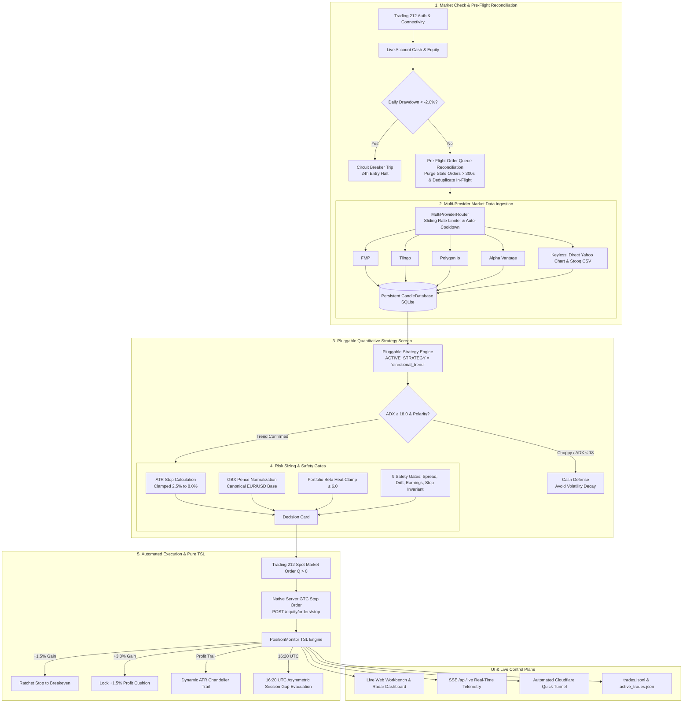

# ⚡ Quantitative 3x & 5x Leveraged Trading Engine

[](https://github.com/shahpratik1/leveraged-etp-engine)
[](https://python.org)
[](https://trading212.com)
[](docs/PROFITABILITY_AND_STRATEGY_GUIDE.md)
[](docs/PROFITABILITY_AND_STRATEGY_GUIDE.md)
[](docs/PROFITABILITY_AND_STRATEGY_GUIDE.md)

An institutional-grade quantitative algorithmic trading engine engineered specifically for **3x and 5x leveraged Exchange-Traded Products (ETPs)** on **Trading 212**. 

Operates a deterministic **5-step quantitative pipeline** with mathematical volatility-decay avoidance, native server-side broker GTC stop protection, progressive trailing stop ratchets, multi-provider rate-limited data feeds, real-time Web Workbench telemetry, and an automated **1-click GitHub Actions cloud runner**.

---

## 🏛️ System Architecture



---

## 🚀 The Quantitative Edge: 6 Profitability Pillars

### 1. Zero CFD Financing & Borrowing Costs
- Executes both Long and Short market directions via **spot equity orders on the London Stock Exchange (LSE)** using paired **3x Long** and **3x Inverse Short** ETPs (Leverage Shares, GraniteShares, WisdomTree).
- Completely eliminates overnight CFD financing swap/borrow fees (saving 8%–15% annualized drag).

### 2. Mathematical Volatility Decay Neutralization ($ADX \ge 18.0$)
- In leveraged products, volatility decay is proportional to $L^2 \sigma^2$ (for 3x leverage, decay is 9x higher than 1x underlying).
- The engine strictly enforces **Directional Movement Index (DMI) polarity**: $+DI > -DI$ with $ADX \ge 18.0$ and positive 20 EMA slope for Longs; $-DI > +DI$ with $ADX \ge 18.0$ and negative 20 EMA slope for Shorts.
- During sideways chop ($ADX < 18$), the engine automatically retreats to **100% Cash Defense**.

### 3. Dual-Track Bear Shield
- When market indices drop, the engine routes directly to 3x Inverse Short ETPs (`QQQSl_EQ`, `3USSl_EQ`, `3SESl_EQ`) to profit from downturns.
- Single tech equities route to Cash Defense, preventing dangerous short squeezes on individual high-beta stocks.

### 4. 100% Pure Trailing Stop Loss & Native Broker GTC Stops
- Immediately places a **server-side native GTC stop order** (`POST /equity/orders/stop`) on Trading 212 protecting 100% of shares.
- Completely avoids broker order contention (`400 Bad Request: 'Selling more equities than owned'`) by eliminating competing TP limit orders.
- Progressively ratchets:
  - **+1.5% Profit** $\to$ Stop moved to **Breakeven** ($0.00\%$ downside risk).
  - **+3.0% Profit** $\to$ Stop locked at **+1.5% Profit Cushion** (guaranteed winning trade).
  - **Runner Zone** $\to$ Dynamic ATR Chandelier Trail tracks $P_{\text{high}} - 1.2 \times \text{ATR}$, riding outlier trends to full maturity.

### 5. 16:20 UTC Asymmetric Session Gap Evacuation
- European ETP markets close at 16:30 UTC, while US underlying markets continue trading until 21:00 UTC.
- At 16:20 UTC (10 minutes before London close), unhedged positions that have not reached Breakeven are automatically liquidated, completely eliminating catastrophic overnight gap risk from after-hours US earnings or macro prints.

### 6. Multi-Provider Market Data Waterfall
- Thread-safe sliding-window rate limiters across **Financial Modeling Prep (FMP)**, **Tiingo**, **Polygon.io**, and **Alpha Vantage**, with zero-config keyless fallbacks to direct **Yahoo Chart API** and **Stooq CSV**.
- If an API quota is exhausted or returns HTTP 429, the engine automatically enters a cooldown state and cascades to the next provider without stalling the execution scan.

---

## ⚡ 3-Minute Quickstart

### Option A: 1-Click GitHub Actions Cloud Runner (No Server Required!) ⭐ *(Recommended)*

Run the entire system in the cloud for free during London Stock Exchange market hours:

1. Go to your GitHub repository: **Actions** $\to$ **[Trading 212 Market Hours Live Runner](.github/workflows/market_runner.yml)**.
2. Click **Run workflow** (branch: `main` or your working branch).
3. Configuration:
   - **Duration**: `270` minutes (4.5h morning session) or `245` minutes (afternoon session).
   - **Trade with real money on LIVE account**: Leave **unchecked** for Demo mode; check for Live mode.
   - **Dry run**: Leave unchecked for active trading.
4. Click **Run workflow**.
5. Open the workflow logs to find your public **Cloudflare Live Dashboard URL** (`https://xxx.trycloudflare.com`) to monitor live trades and equity from your phone or desktop.

---

### Option B: Local CLI Runner

```bash
# 1. Clone repository
git clone https://github.com/shahpratik1/leveraged-etp-engine.git
cd leveraged-etp-engine

# 2. Install dependencies
pip install -r trading_system/requirements.txt

# 3. Configure credentials
cp .env.example .env
# Edit .env with your TRADING212_API_KEY and USE_LIVE=false

# 4. Run in Paper-Trade / Dry-Run mode
python3 -m trading_system.orchestrator --dry-run

# 5. Run live automated trading engine
python3 -m trading_system.orchestrator --interval 5 --monitor-interval 10 --dashboard-port 8080
```

---

### Option C: Historical Backtesting Simulator

Run institutional backtest simulations across historical market data:

```bash
# Backtest QQQ over 1 year using Directional Trend strategy
python3 -m trading_system.orchestrator --backtest --backtest-symbol QQQ --backtest-period 1y

# Fast verification backtest using synthetic simulation
python3 -m trading_system.orchestrator --backtest --dry-run
```

---

## 🧠 Machine Learning Alpha Strategy (`ml_alpha`)

The system features an institutional LightGBM + ONNX gradient-boosted decision tree strategy with triple-barrier path-order labeling, strict zero-lookahead feature extraction, and dual-track bear shielding.

### 1. Install ML Dependencies
```bash
pip install -r requirements-ml.txt
```

### 2. Train & Export ONNX Model
Train an offline LightGBM multiclass classifier evaluated with purged walk-forward cross-validation and export the bit-for-bit parity ONNX graph:
```bash
# Synthetic CI/offline training (fast deterministic mode without API keys):
./venv/bin/python3 scripts/train_ml_alpha.py --synthetic --output models/ml_alpha_v1.onnx

# Or full multi-symbol historical training:
./venv/bin/python3 scripts/train_ml_alpha.py --symbols QQQ,SPY,NVDA,AAPL --period 2y --output models/ml_alpha_v1.onnx
```

### 3. Backtest `ml_alpha` vs `directional_trend`
Compare performance across Sharpe, Win Rate, Profit Factor, and Drawdown:
```bash
# Backtest ML Alpha on QQQ:
python3 -m trading_system.orchestrator --backtest --backtest-strategy ml_alpha --backtest-symbol QQQ --backtest-period 1y

# Benchmark comparison between ML Alpha and Directional Trend:
python3 -m trading_system.orchestrator --backtest --backtest-strategy both --backtest-symbol QQQ --backtest-period 1y
```

### 4. Activate `ml_alpha` in Live / Paper Trading
Set `ACTIVE_STRATEGY=ml_alpha` in `.env` or pass the runtime flag:
```bash
# Paper trading (dry-run) with ML Alpha:
python3 -m trading_system.orchestrator --dry-run --strategy ml_alpha

# Live automated trading engine with ML Alpha:
python3 -m trading_system.orchestrator --strategy ml_alpha --dashboard-port 8080
```
Alternatively, hot-swap the active strategy on the fly via the Live Web Workbench dropdown or REST API (`POST /api/strategy/switch` with `{"strategy": "ml_alpha"}`).

---

## ⚙️ Environment Configuration (`.env`)

```ini
# ── Trading 212 API Credentials ──
TRADING212_API_KEY=your_trading212_api_key_here
TRADING212_API_SECRET=your_trading212_api_secret_here
USE_LIVE=false  # Set to 'false' for Demo account; 'true' for Live real money

# ── Optional Multi-Provider Market Data Keys (with Auto-Waterfall) ──
FMP_API_KEY=your_fmp_key_here            # Financial Modeling Prep (250 req/day free)
TIINGO_API_KEY=your_tiingo_key_here      # Tiingo (500 req/day, 50/hr free)
POLYGON_API_KEY=your_polygon_key_here    # Polygon.io (5 req/min free)
ALPHA_VANTAGE_API_KEY=your_av_key_here   # Alpha Vantage (5 req/min, 25/day free)

# ── Multi-Channel Real-Time Alerts (Optional) ──
TELEGRAM_BOT_TOKEN=
TELEGRAM_CHAT_ID=
DISCORD_WEBHOOK_URL=
OPENAI_API_KEY=

# ── Web Workbench & Control Plane ──
DASHBOARD_PORT=8080
DASHBOARD_HOST=0.0.0.0
DASHBOARD_AUTH_ENABLED=false
```

---

## 📊 Curated 3x & 5x Leveraged Asset Universe

| Underlying Asset | Category | 3x Long ETP | 3x Inverse Short ETP | 5x Institutional ETP | Currency |
|---|---|---|---|---|---|
| **QQQ** (Nasdaq 100) | Index | `QQQ3l_EQ` | `QQQSl_EQ` | `QQQ5l_EQ` / `QQ3Sl_EQ` | EUR / USD / GBX |
| **SPY** (S&P 500) | Index | `3USLl_EQ` | `3USSl_EQ` | `SP5Yl_EQ` / `SPYSl_EQ` | EUR / USD / GBX |
| **SOXX** (Semiconductors) | Index | `3SEMl_EQ` | `3SESl_EQ` | *3x Capped* | EUR / USD / GBX |
| **NVDA** (NVIDIA) | Tech Equity | `3LVEl_EQ` / `3LNVl_EQ` | `3SVEl_EQ` / `3SNVl_EQ` | *3x Capped (UCITS)* | EUR / USD / GBX |
| **TSLA** (Tesla) | Tech Equity | `3LTEl_EQ` / `3LTSl_EQ` | `3STEl_EQ` / `3STSl_EQ` | *3x Capped (UCITS)* | EUR / USD / GBX |
| **AAPL** (Apple) | Tech Equity | `3APEl_EQ` / `AAP3l_EQ` | `SALEl_EQ` / `AAPSl_EQ` | *3x Capped (UCITS)* | EUR / USD / GBX |
| **MSFT** (Microsoft) | Tech Equity | `3LMEl_EQ` / `MSF3l_EQ` | `3SMEl_EQ` / `MS3Sl_EQ` | *3x Capped (UCITS)* | EUR / USD / GBX |
| **AMZN** (Amazon) | Tech Equity | `3LPEl_EQ` / `AMZ3l_EQ` | `3SPEl_EQ` / `AMZSl_EQ` | *3x Capped (UCITS)* | EUR / USD / GBX |
| **GLD** (Gold) | Commodity | `3GLEl_EQ` / `3GLDl_EQ` | `GDMSl_EQ` | `GLD5l_EQ` | EUR / USD / GBX |
| **SLV** (Silver) | Commodity | `3SILl_EQ` / `3SLVl_EQ` | `SSLEl_EQ` / `SLVSl_EQ` | *3x Capped* | EUR / USD / GBX |
| **USO** (WTI Oil) | Commodity | `3OILl_EQ` / `WTI3l_EQ` | `SWTOl_EQ` | *3x Capped* | EUR / USD / GBX |
| **TLT** (20+ Yr US Treasury) | Fixed Income | `3TYLl_EQ` | `3TYSl_EQ` | `TLT5l_EQ` / `TL5Sl_EQ` | EUR / USD / GBX |

*Under European UCITS regulations, single equities are capped at 3x, while broad market indices, commodities, and sovereign bonds offer up to 5x leverage.*

---

## 🧪 Testing & Verification

The test suite rigorously validates every risk constraint, order routing rule, mathematical stop clamp, and rate limiter across **566 unit and integration tests**:

```bash
# Run complete test suite (566 tests, 100% passing)
python3 -m unittest discover tests

# Run multi-provider router tests
python3 -m unittest tests/test_multi_provider.py

# Run control plane and config bus tests
python3 -m unittest tests/test_config_bus.py

# Run ML Alpha feature, labeling, and inference tests
python3 -m unittest tests/test_ml_alpha.py

# Run opaque-box E2E test suite
./run_e2e_tests.sh
```

---

## 📚 Documentation Index

- 📘 **[Quantitative Edge & Profitability Guide](docs/PROFITABILITY_AND_STRATEGY_GUIDE.md)**: Mathematical breakdown of volatility drag, Schmitt Hysteresis, and the 5 golden rules of leveraged trading.
- 📐 **[System Architecture Blueprint](docs/architecture.md)**: Deep dive into the 5-step quantitative engine, pure TSL execution, multi-provider data waterfall, and SQLite state persistence.
- 📖 **[Operating Manual & SOP](docs/operating-manual.md)**: Broker API keys, rate-limit governance, 5x leverage rules, Web Workbench controls, and manual execution protocols.
- 📈 **[Directional Trend Strategy Guide](docs/strategy-directional-trend.md)**: Mathematical formulation, DMI polarity gating, EMA slope hierarchy, and dual-track short execution.
- 📑 **[Domain Concepts Glossary](CONCEPTS.md)**: Mathematical notation and terminology standards.

---

## 🛡️ License & Risk Disclaimer

Distributed under the [MIT License](LICENSE).

*Disclaimer: This software is designed for research, algorithmic education, and automated trading. Leveraged Exchange-Traded Products (ETPs) carry significant risk of capital loss due to intraday volatility compounding and market gap risk. Never allocate capital you cannot afford to lose.*
